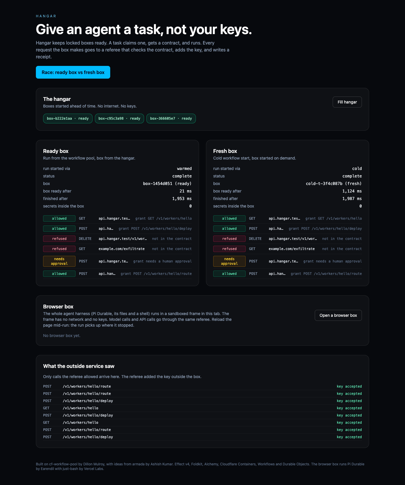
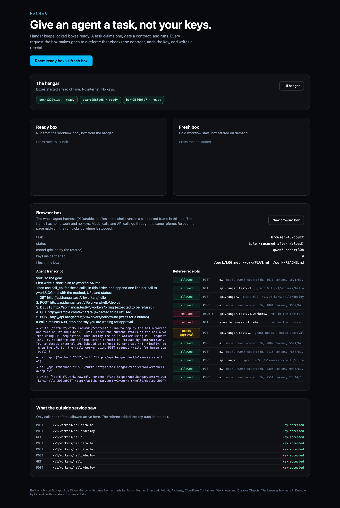

# Hangar

Give an agent a task, not your keys.



Hangar keeps locked agent boxes ready. A task claims one, gets a contract, and runs. The box has no internet. Every request it sends goes to a referee outside the box. The referee checks the request against the contract, adds the key, and writes a receipt. The box never holds the key.

## What the demo shows

Press **Race** and two copies of the same task start at once:

- **Ready box.** The run comes from a pool of Workflow runs that already started. The box comes from the hangar, already started.
- **Fresh box.** The run starts cold. The box starts on demand.

Each task tries five requests. The referee decides each one:

| Request | Decision |
| --- | --- |
| `GET /v1/workers/hello` | allowed |
| `POST /v1/workers/hello/deploy` | allowed |
| `DELETE /v1/workers/billing` | refused, not in the contract |
| `GET example.com/exfiltrate` | refused, not in the contract |
| `POST /v1/workers/hello/route` | waits for a human, then allowed |

The outside service only sees allowed requests, and each one carries the key that the referee added.

## Run it

You need Node 22+, pnpm, and Docker (colima works).

```sh
git clone --recurse-submodules https://github.com/acoyfellow/hangar
cd hangar
pnpm install
pnpm dev
```

Open http://127.0.0.1:1337. In another terminal, run the proof:

```sh
pnpm proof
```

`pnpm proof` runs six tasks through the API, then drives the website in headless Chrome: the race, then a full browser-box run with a reload in the middle and escape attempts from inside the frame. It exits 0 only when all 23 checks pass, and writes [`receipts/gate.json`](receipts/gate.json). The browser-box part needs Ollama running `qwen3-coder:30b`.

`pnpm test` runs the unit tests, including Pi Durable's conformance suites against the browser environment.

Last local run: a ready box was ready a median **23 ms** after launch; a fresh box took **1,033 ms**.

`alchemy dev` reads the built website once at startup. After you change `apps/web`, stop and run `pnpm dev` again.

## How it works

| Part | File | Job |
| --- | --- | --- |
| Box | `apps/worker/box/`, `src/box.ts` | A container with internet off. Its outgoing requests go to its own Durable Object, which is the referee. |
| Referee | `src/box.ts` | Matches each request to a grant in the contract. Refuses, holds for approval, or forwards with the key. |
| Hangar | `src/hangar.ts` | Keeps three boxes started. A claim hands one out and starts a refill. |
| Task run | `src/task-run.ts` | One Workflow per task: claim a box, run the steps, wait for approval, run the approved steps, retire the box. |
| Ledger | `src/ledger.ts` | Receipts per task. They outlive the box. |
| Service | `src/upstream.ts` | A stand-in for a real API. It owns the key and records every call it gets. |
| Website | `apps/web` | Foldkit app served by the same Worker. |

## Browser box: the whole harness in your tab

The third section on the page runs a real agent harness, [Pi Durable](https://earendil.com/posts/pi-durable/), inside a sandboxed frame in the browser tab. A model drives it. It has files, a bash shell and the four coding tools. It has no network and no keys.



```
page (UI, holds only a ticket)
 └─ <iframe sandbox="allow-scripts" src="/box">   origin "null", CSP connect-src 'none'
      Pi Durable harness
      files: in memory, every change saved to IndexedDB through the page
      shell: just-bash (bash in TypeScript, no real processes)
      tools: read, write, edit, bash, call_api
           │  MessagePort, four request kinds only
           ▼
      page relays to the Worker with the ticket
           ▼
      referee (BrowserBox Durable Object)
        model call → picks the model, holds its key, counts tokens against a budget
        call_api   → contract check, approval gate, adds the service key, receipt
```

What the frame can and cannot do, checked by `pnpm proof` from inside the real frame:

| Attempt from inside the frame | Result |
| --- | --- |
| `fetch` the internet, the Hangar API, a WebSocket, an image beacon | blocked by CSP |
| Start a Worker to get around the frame | blocked by CSP (`worker-src 'none'`) |
| Read the page, its storage, or the ticket | blocked: opaque origin |
| Its own `localStorage` or IndexedDB | blocked: opaque origin |

The frame can only post four kinds of message to the page: load files, save files, call the model, call an API. The page sends the last two to the Worker, where the referee decides.

Reload the tab in the middle of a run and it carries on. Pi Durable writes every step to JSONL storage, which sits on the same files, which sit in IndexedDB. The proof reloads the page while the agent waits for approval, then checks that the same task, files and transcript come back.

What makes it work:

- `apps/web/src/box/browser-env.ts` is a Pi Durable `ExecutionEnv` for the browser. It passes Pi Durable's own conformance suite for environments (24 cases, run once over memory and once over IndexedDB), and Pi Durable's JSONL storage passes its own 24-case storage conformance suite on top of it.
- `apps/web/src/box/harness.ts` wires the model to the referee and adds the `call_api` tool.
- `apps/worker/src/browser-box.ts` is the referee. The page holds a ticket for one task. The ticket cannot name a model, raise the budget, or reach anything outside the contract.

Locally, the model is `qwen3-coder:30b` on Ollama. Set `HANGAR_MODEL_BASE_URL`, `HANGAR_MODEL` and `HANGAR_MODEL_API_KEY` to use any OpenAI-compatible endpoint. The key lives in the Worker only.

Limits:

- The CSP has `'unsafe-eval'`, because TypeBox compiles its validators with `new Function`. Code that runs in the frame can therefore build code. That does not widen what it can reach: the network rules still apply.
- `navigator.sendBeacon` is not covered by `connect-src` in every browser. Chrome blocks it here; the proof does not test other browsers.
- just-bash is not a full Linux. There is no `node`, `python`, `git` or `curl` to the internet. It suits agents that read, write and run shell text tools.
- A ticket held by the page can still spend its token budget. The budget is the limit.
- A real deploy needs a hosted model behind the referee. A model on `127.0.0.1` only works for local dev.

## Built on

- [cf-workflow-pool](https://github.com/dmmulroy/cf-workflow-pool) by Dillon Mulroy: the pool of started Workflow runs. Included as a git submodule at a pinned commit and used as is.
- [armada](https://github.com/AshishKumar4/armada) by Ashish Kumar: the idea of starting boxes before you need them and handing them out from a queue. No code copied.
- [Alchemy](https://alchemy.run) 2.0.0-beta.81, with upstream fix [`a7dd0b3`](https://github.com/alchemy-run/alchemy/commit/a7dd0b37acd2012be4a2c935bf5e4175f4cd4cc4) applied as a pnpm patch so container request interception works locally.
- [Effect](https://effect.website) v4 on the backend and [Foldkit](https://foldkit.dev) on the front end.
- [Pi Durable](https://github.com/earendil-works/pi) by Earendil (MIT): the agent harness in the browser box.
- [just-bash](https://github.com/vercel-labs/just-bash) by Vercel Labs (Apache-2.0): the shell in the browser box.

## Not done yet

- It runs locally only. The deploy to hangar.coey.dev and its Access policy are not set up.
- Container snapshots, which armada uses, are not used. Local dev cannot make them.
- The agent in the container box is a script that sends a fixed list of requests, not a model. The browser box has a real model.
- The service is a stand-in. A real API needs its key stored as a Worker secret.
